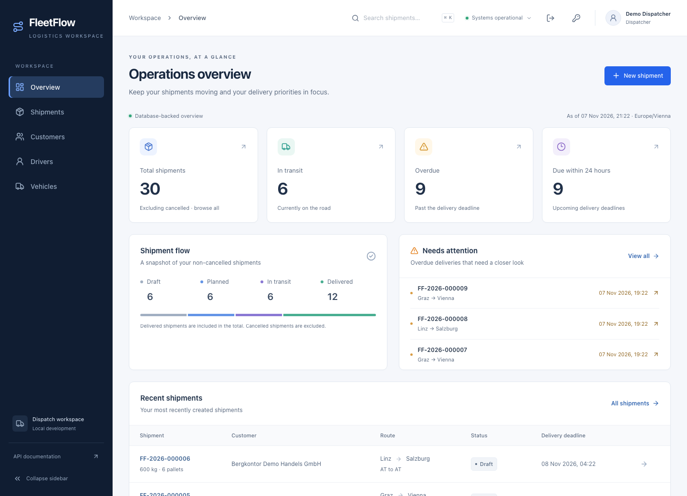
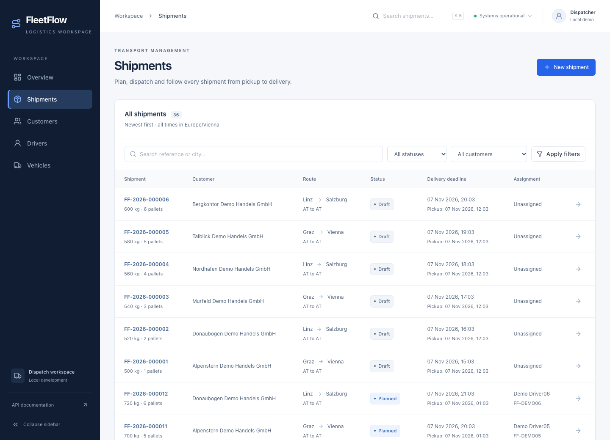
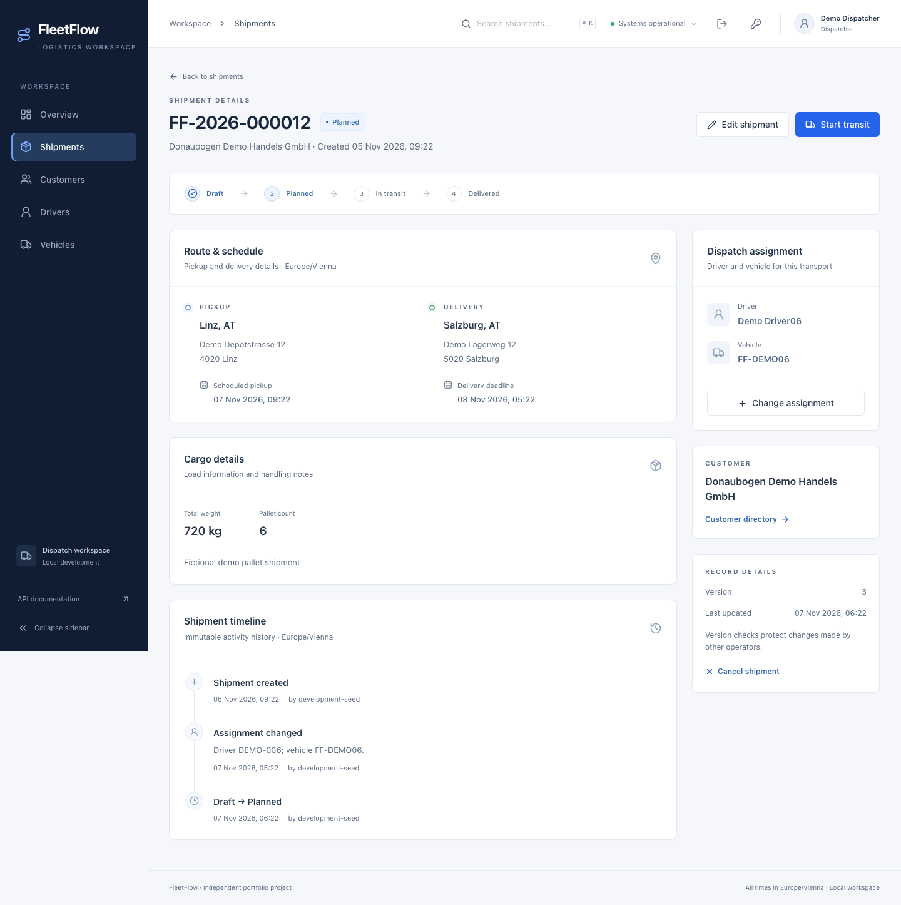
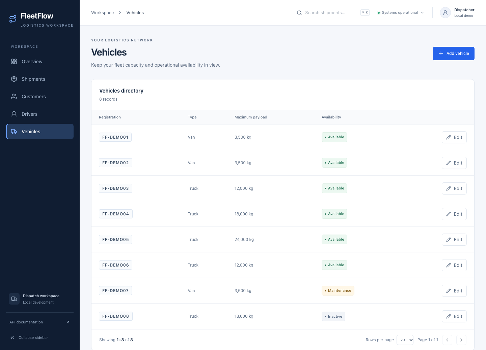
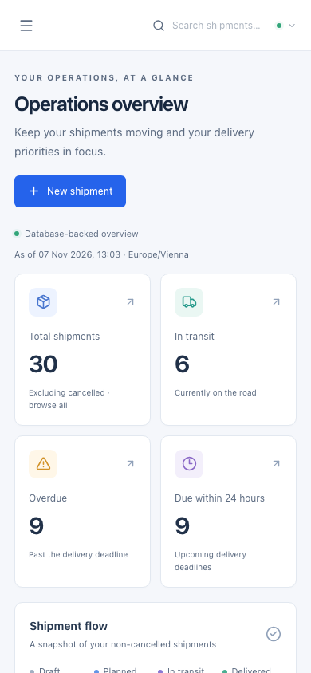
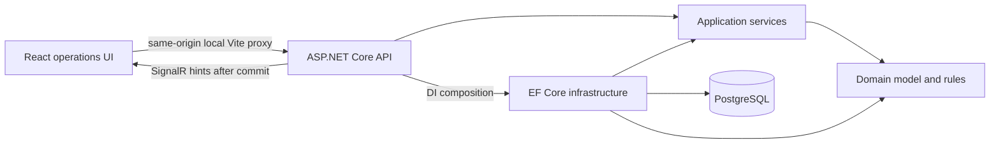
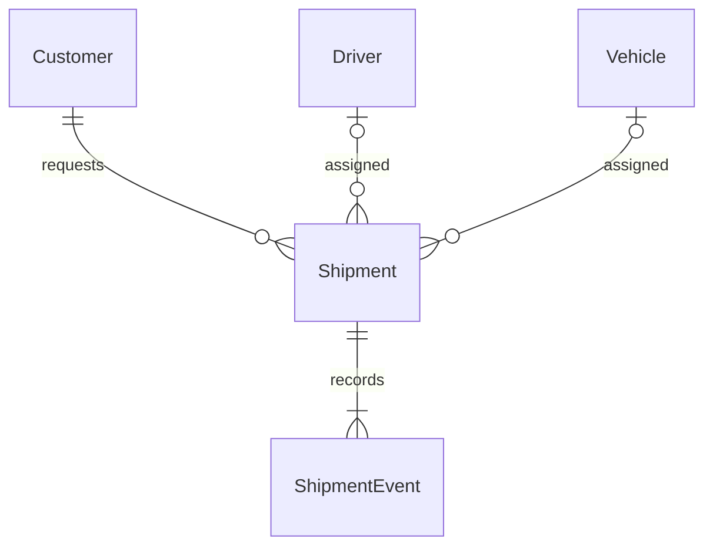
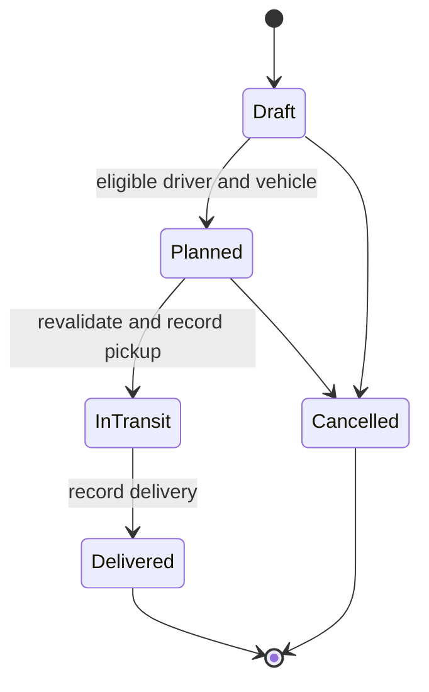

# FleetFlow

**Logistics operations and dispatch management — a C#/.NET and React portfolio project.**

FleetFlow helps a dispatcher create transport orders, assign eligible drivers and vehicles, follow delivery deadlines and investigate an immutable shipment timeline. It is an independently designed personal project with entirely fictional demo data.

The emphasis is on engineering behind a usable product: backend-enforced business rules, relational constraints, transactional history, concurrent reservation handling and a real PostgreSQL-backed operations interface.

> **Local development only.** ASP.NET Core Identity cookie authentication and Admin/Dispatcher/Viewer roles are implemented. Deployment hardening is still incomplete; do not expose this local application publicly.

## What you can do

- Sign in with a managed account, use role-appropriate operations and change your password.
- Administrators can provision users and revoke access immediately.
- Collaborate through authenticated SignalR updates, with reconnect recovery and retained unsaved edits.
- Monitor actual shipment counts, overdue deliveries, upcoming deadlines and recent orders.
- Inspect verified operational findings and evidence; optionally request a quota-limited, grounded AI summary through Cloudflare Workers AI (disabled until manually verified).
- Search and filter shipments in PostgreSQL, with URL-synchronized filters and pagination.
- Create transport orders with full addresses, cargo details, decimal weights and schedules.
- Assign an active driver and an available vehicle with sufficient payload capacity.
- Progress a shipment through its lifecycle or cancel it where allowed.
- Review persisted events, actual pickup/delivery timestamps and shipment versions.
- Create customers and create/edit drivers and vehicles.
- Use the responsive interface with keyboard navigation, accessible dialogs and actionable conflict/error states.

All application data comes from the REST API. There are no production-UI mock datasets, fabricated KPIs, GPS tracking or AI predictions.

## Screenshots

Captured from the actual application against a fresh, isolated PostgreSQL database containing the development seed. Dates and counts reflect capture time; they are not hardcoded into the UI.







<details>
<summary>Fleet directory and mobile layout</summary>





</details>

[Reproduce the screenshots](docs/screenshots.md). Screenshots use only fictional seed records, never a developer's existing database.

## Technology

| Area | Implementation |
| --- | --- |
| Backend | C#, .NET 10 LTS, ASP.NET Core controllers, built-in DI/logging/OpenAPI |
| Live updates | ASP.NET Core SignalR, Identity cookies, typed invalidation hints and REST recovery |
| Logistics intelligence | Deterministic C# rules/SQL, optional direct Cloudflare Workers AI REST, persistent usage budgets |
| Persistence | EF Core 10, Npgsql 10, PostgreSQL 18, versioned migrations |
| Frontend | React, TypeScript, Vite, React Router, Tailwind CSS, shadcn-style Radix components, Lucide |
| Forms/server state | React Hook Form, Zod, TanStack Query |
| Tests | xUnit v3/Microsoft.Testing.Platform, real PostgreSQL Testcontainers, Vitest/RTL, Playwright and axe-core |
| Delivery checks | Docker Compose, GitHub Actions, dependency audits, Cobertura and V8 coverage |

Exact tool versions live in `global.json`, `.nvmrc`, `Directory.Packages.props` and the lockfiles. Updates are reviewed changes, not floating installs.

## Architecture



FleetFlow is a **modular monolith**. One API and one database keep transactions, deployment and debugging understandable. Microservices and a message broker would add coordination costs without solving a current product problem.

- **Domain** owns validated entities, status transitions and assignment eligibility, with no ASP.NET Core or EF dependency.
- **Application** orchestrates use cases through focused persistence/query boundaries and `TimeProvider`.
- **Infrastructure** implements EF mappings, SQL projections, PostgreSQL transactions, resource locks, migration and development seeding.
- **API** handles HTTP binding, dedicated DTOs, validation, ProblemDetails and dependency injection. EF entities are never serialized as API contracts.

The frontend is organized into dashboard, shipments, customers, drivers, vehicles, authentication, realtime and insights features. TanStack Query owns server state; local React state holds dialogs and deliberate edit snapshots. OpenAPI-generated types provide compile-time contracts and Zod checks responses at runtime.

[Architecture and decisions](docs/architecture.md) · [API v1 contract](docs/api/v1.md) · [Real-time design](docs/realtime.md) · [Insights and optional AI](docs/insights.md)

## Domain and persistence



A shipment has one customer, two address values, a pickup/deadline interval, cargo weight/pallets and an optional driver/vehicle pair. Addresses are EF complex values stored in shipment columns. Foreign keys restrict deletion; unique constraints protect employee numbers, normalized plates and shipment numbers. Check constraints validate status, schedules, weights, versions and assignment consistency. History cannot be updated or deleted through the application; a PostgreSQL trigger also protects stored events.

Weights use C# `decimal` and PostgreSQL `numeric(12,2)`. Timestamps are UTC instants. The interface explicitly uses Europe/Vienna, including DST-safe input conversion. The initial EF migration is exercised by actual PostgreSQL tests, including rollback/reapply and model consistency.

## Shipment lifecycle and business rules



Examples of enforced rules:

- A 4,000 kg load cannot be assigned to a 3,500 kg van.
- Inactive drivers and vehicles in Maintenance/Inactive cannot be assigned.
- A driver or vehicle cannot serve overlapping Planned/InTransit shipments. Reservations use half-open `[pickup, deadline)` windows; adjacent transports are allowed.
- Draft selections do not reserve resources; planning rechecks eligibility and overlap under database row locks.
- Draft fields are editable; Planned permits only cargo-description edits. Assignment locks once transit starts.
- Each successful status change and its single event commit atomically. Failed actions leave no partial state or duplicate events.
- Shipment mutations require the expected `version`. Stale writes return HTTP 409; the UI requires explicit reload rather than overwriting another operator.

This is a deliberately documented MVP simplification: multiple orders on one trip are not modeled. Shipment numbers use a database sequence with a UTC-year prefix; gaps are normal and the sequence does not reset each year.

## Run locally

Prerequisites: Docker Desktop/Engine with Compose v2, Node **24.22.2**, npm, a POSIX shell and OpenSSL. Install .NET SDK **10.0.403** for backend development/tests, and Python 3 for audit/report helpers. macOS Apple Silicon is verified; Linux is the configured CI target. Windows users should use WSL2 with Docker integration; native Windows setup is not verified.

From a clone of this repository:

```sh
# If using nvm:
nvm install
nvm use

# Generates an ignored password, builds/starts API + PostgreSQL,
# applies the migration/fictional seed, installs frontend dependencies,
# then runs Vite in the foreground.
sh scripts/dev.sh
```

Open **[FleetFlow](http://127.0.0.1:5173)**. A host .NET SDK is not needed just to run the Docker-backed application. Sign in with `admin@fleetflow.example`, `dispatcher@fleetflow.example` or `viewer@fleetflow.example`; your generated initial passwords are in ignored `.env.demo`. Never publish this file. [Authentication and demo-account guide](docs/authentication.md).

Prefer individual steps?

```sh
sh scripts/setup-env.sh
docker compose -p fleetflow up --build -d --wait
docker compose -p fleetflow run --rm --no-deps api --migrate --seed
sh scripts/demo-users.sh
npm ci --prefix frontend
npm run dev --prefix frontend
```

The seed is Development-only and idempotent. Rerunning does not erase existing demo edits or move dates. It refuses to overwrite an unrelated non-demo database. It creates 10 fictional customers, 12 drivers, 8 vehicles and 36 shipments with history. Deadline examples are relative to the first seed/reset time.

| Service | Local address |
| --- | --- |
| UI | `http://127.0.0.1:5173` |
| API liveness / database readiness | `http://127.0.0.1:5080/health` / `/health/ready` |
| Development OpenAPI | `http://127.0.0.1:5080/openapi/v1.json` |
| PostgreSQL | `127.0.0.1:5433` |

Compose publishes only on loopback. Vite proxies `/api`, `/health` and `/openapi`; no CORS relaxation or browser database credentials are needed. Configure Compose with the ignored root `.env`; optional frontend overrides are described in `frontend/.env.example`. Never place secrets in browser-exposed `VITE_*` values.

Stop Vite with Ctrl+C and containers with `docker compose -p fleetflow down`; the database volume is preserved. To deliberately **delete only the development database** and rebuild fresh fictional data:

```sh
sh scripts/reset-demo.sh --confirm
```

[Detailed setup, host .NET development and troubleshooting](docs/setup.md)

## Develop and test

```sh
dotnet tool restore
dotnet restore backend/FleetFlow.slnx --locked-mode
dotnet build backend/FleetFlow.slnx -c Release --no-restore
dotnet format backend/FleetFlow.slnx --verify-no-changes --no-restore
sh scripts/test-backend.sh
python3 scripts/audit-dotnet.py

npm ci --prefix frontend
npm run check --prefix frontend
npm audit --prefix frontend --audit-level=moderate

cd frontend
npx playwright install --with-deps chromium firefox webkit
npm run test:e2e
# Explicit Chromium-only shortcut for local iteration:
npm run test:e2e:chromium
```

The backend uses xUnit with Microsoft.Testing.Platform, **not VSTest**. Integration fixtures own fresh PostgreSQL 18 containers/databases, exercising real constraints, migration, SQL queries, transaction rollback and concurrent writes. No EF InMemory provider certifies database behavior.

The default E2E command runs Chromium, Firefox and WebKit; `test:e2e:all` remains an equivalent alias. Playwright is temporarily pinned to 1.64.1 because 1.65.0 exposes a confirmed Firefox ARIA-reflection crash during accessibility scans. No browser or WCAG rule is excluded. See the [M4.1 stabilization report](docs/m41-verification.md) for local results, the upgrade gate and the separate hosted-CI status.

Playwright starts a separate disposable API/PostgreSQL/Vite stack on loopback ports **5180/5434/5174**. It applies migration/seed, verifies real user journeys, audits accessibility and tears down only its own test volume. It does not use or reset the development database. Keep those ports free and run one invocation at a time; each invocation uses one worker and test-owned resources.

Coverage reports are generated under `artifacts/backend/` and `frontend/coverage/`. Inspect coverage to find missing behaviors, not to chase an arbitrary percentage. `python3 scripts/coverage-summary.py` prints per-suite/per-assembly results. Generated API contracts, EF migration/snapshot files and the frontend bootstrap are excluded from line metrics; migration execution is still tested.

[Testing guide and coverage scope](docs/testing.md) · [M4 verification history](docs/m4-verification.md) · [M4.1 browser/CI verification](docs/m41-verification.md) · [M5a authentication verification](docs/m5a-verification.md) · [M5b real-time verification](docs/m5b-verification.md) · [M6 analytics/AI verification](docs/m6-verification.md)

## Continuous integration

[`.github/workflows/ci.yml`](.github/workflows/ci.yml) defines checks for every pull request and push to `main`:

- **Backend:** locked restore, Release build, formatting, migration consistency, PostgreSQL tests, coverage and NuGet audit.
- **Frontend:** `npm ci`, lint, format, typecheck, component tests/coverage, production build and npm audit.
- **E2E matrix:** Chromium, Firefox and WebKit against the actual isolated Docker stack, plus API type-drift and accessibility checks.

The workflow uses read-only repository permissions, disabled checkout credential persistence, lockfile-based dependency caching and scoped diagnostic artifacts. It has no deployment step or deployment credentials. Dependabot configuration proposes reviewed dependency updates; it does not auto-merge them.

**Hosted status:** workflow configuration is locally validated; successful GitHub-hosted execution must be confirmed after the changes are pushed. No green hosted-CI claim is implied. [CI design and validation](docs/ci.md)

## API and demo walkthrough

Open the Development OpenAPI document or [API guide](docs/api/v1.md) for request DTOs, responses, validation, filters, paging and `version` preconditions.

```sh
curl --fail http://127.0.0.1:5080/health/ready
# Logistics calls require an Identity session cookie; writes also need X-CSRF-TOKEN.
```

A practical interview demo: create a Graz–Vienna order, assign an eligible driver/vehicle, plan it, start transit and mark it delivered. Inspect the real event timeline and dashboard changes. Then demonstrate a stale version or overlapping reservation conflict and the corresponding automated test.

## Operational insights and optional AI

Open **AI Insights** after signing in. PostgreSQL-backed rules identify overdue/in-transit overdue shipments, deadlines within 24 hours, started Planned pickup windows, unassigned Drafts and resource eligibility issues. Findings include recorded evidence and shipment links. They work fully without an external account or API key.

**Generate AI Analysis** is an explicit action available only to individually approved accounts. A server-side Cloudflare Workers AI client uses `@cf/zai-org/glm-4.7-flash` to assemble validated fact sentences and prioritize approved dispatcher suggestions. It receives no free-text cargo/customer/driver information and cannot change business records. The UI distinguishes verified findings from AI-selected suggestions; no GPS, delay causes or ETAs are invented.

External inference defaults to **off**. Before enabling it, manually verify Workers Free, the exact model, current terms/EEA applicability, an entirely fictional dataset and an account without paid billing/credits. No credit card or paid plan is part of this implementation. Defaults are 3 attempts/user/UTC day, 20 globally, one global concurrent generation, 500 output tokens, bounded input and a short timeout. Attempts—including failures—are persisted; identical results have a five-minute per-user cache. These safeguards do not guarantee provider quota availability or permanent zero-cost service.

See [configuration, quotas, security and manual token setup](docs/insights.md), [actual M6 verification](docs/m6-verification.md) and [future zero-cost hosting assessment](ZERO_COST_DEPLOYMENT.md). No live inference, external account setup or deployment is needed for local development or automated tests. Browser tests preserve the real API, PostgreSQL, Identity and CSRF while replacing only the external provider in a separate test-only host.

## Security and limits

Identity sessions, CSRF and server-enforced role policies secure logistics endpoints. This remains a **local portfolio application without production deployment readiness**. Local HTTP cookies and unencrypted-at-rest development Data Protection keys must not be reused as a public deployment configuration.

The API returns safe ProblemDetails, avoids unfiltered unexpected-exception logs, rejects unknown request fields and adds no-store/nosniff headers. The API container runs as non-root with a read-only root filesystem, temporary scratch space, dropped capabilities and no privilege escalation. The local database role remains privileged for development migration/seed; it is not a production service account.

Before public deployment: verify HTTPS/proxy/host policies, encrypt and restrict the key ring, define MFA/account recovery and administrator bootstrap, add deployment-appropriate abuse controls, least-privilege database roles, managed secrets, operational logging/retention, backups/recovery and a deployment security review. Audit results are time-specific, not proof of absence of vulnerabilities. [Security review and threat model](docs/security.md) · [Identity architecture and limitations](docs/authentication.md)

Other boundaries: English UI and fixed Vienna display timezone; offset pagination can shift under concurrent writes; master records use existing last-write-wins update semantics; license category is informational; no multi-shipment trips, GPS, pricing, invoicing or export APIs. Ambiguous write failures require checking the record/list before retrying; create requests do not yet have idempotency keys.

## Roadmap

- **M0–M3:** foundation, domain/persistence, REST API and operations UI.
- **M4:** quality review, CI configuration, security/accessibility checks and portfolio documentation.
- **M4.1:** browser toolchain stabilization, repeated accessibility/interaction checks and CI diagnostics; five hosted baseline jobs reported green by the project owner.
- **M5a:** Identity authentication, cookie/CSRF sessions, role policies, managed accounts and verified audit actors.
- **M5b:** authenticated SignalR notifications, session revalidation, live query refresh and multi-user tests.
- **Later, only after approval:** further deployment hardening.
- **M6:** verified operational analytics and optional, explicit Cloudflare Workers AI assistance with persistent quotas and a credential-free test provider.
- **Not started:** M7/mobile or public deployment.

Private planning/instruction documents and actual credentials are excluded from Git and Docker build contexts. Nothing is publicly deployed by this repository.

Licensed under [MIT](LICENSE).
