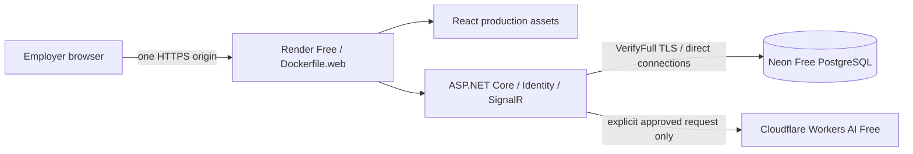

# Zero-additional-cost portfolio deployment preparation

**M7 is implemented locally; nothing is deployed.** No account, cloud resource, billing setting or paid service was created or activated. A separate approval is required for every external setup/release. Provider assumptions were rechecked against official documentation on **2026-11-09** and must be checked again in the actual accounts. A free plan is not a promise of permanent zero-cost availability.

## Target architecture

One service and one persistent database operate independently of the developer's computer. Use provider-supplied HTTPS hostnames; no domain purchase, Worker script, Gateway, Ollama host, paid monitoring, cron or wake-up traffic is required. React and API share cookies/CSRF and the same origin. Public visitors use bounded passwordless Viewer or isolated Dispatcher leases, never Admin credentials. See [demo isolation](docs/portfolio-demo.md) and the [deployment/recovery runbook](docs/deployment.md).

## Verified free-plan assumptions

| Service | Current official basis | Required account decision |
| --- | --- | --- |
| Render | [Free services](https://render.com/docs/free): Docker web services, managed HTTPS, 750 shared instance-hours/month; idle sleep after 15 minutes, ephemeral filesystem, no free shell/one-off jobs or persistent disk | Choose Free, disable auto-deploy, add no payment method or paid extras. Cold starts can take about a minute. No-payment excess bandwidth suspends services; excess build minutes blocks builds. High external traffic can also cause suspension. Never upgrade to resolve exhaustion. |
| Neon | [Plans](https://neon.com/docs/introduction/plans): Free currently includes 100 CU-hours/project, 1 GB/project storage, 5 GB public transfer and five-minute scale-to-zero | Use an ordinary persistent root branch, not an expiring preview/trial. Choose a compatible PostgreSQL version/region, direct endpoint and small pools. Verify the actual quota dashboard and no-card signup. No SLA, unlimited retention or independent backup is implied. |
| Cloudflare | [Workers AI pricing](https://developers.cloudflare.com/workers-ai/platform/pricing/) and [GLM model](https://developers.cloudflare.com/workers-ai/models/glm-4.7-flash/): Workers Free allocation is 10,000 Neurons/account/UTC day; GLM-4.7-Flash remains the approved model | Keep Workers Free; no Paid plan, paid-only models, Gateway inference/credits or billing activation. Provider exhaustion stops requests. FleetFlow's 3/user and 20/global attempts/day do not guarantee the account stays within provider quota. |

Do not use Render Free PostgreSQL: its documented database expires after 30 days. Do not store data or key-ring state on Render's application filesystem. No service's future pricing or availability can be guaranteed. If signup/configuration demands a credit card or paid subscription, stop and report it; no such account flow has been executed by M7.

## Manual account and release prerequisites

1. Obtain explicit approval before creating any external resource. Inspect all account plans, payment methods, quotas and automatic upgrade settings; use only free/no-card options.
2. Later create a Render **Free Docker web service**, with `Dockerfile.web`, health path `/health`, manual releases and the supplied HTTPS hostname. Do not deploy until database initialization, proxy trust and runtime secrets are ready. Render Free has no one-off jobs: run schema initialization from a controlled local image or the explicitly approved manual GitHub maintenance workflow.
3. Later create Neon Free in a suitable region with a persistent root branch. Confirm supported PostgreSQL version by rehearsing migrations and the restricted roles. Follow [Neon's role guidance](https://neon.com/docs/manage/roles): create runtime/maintenance logins with SQL, not administrative Console/API defaults. Use the direct endpoint, VerifyFull and pool limits of ten/two. Do not substitute transaction-mode pooling.
4. Create and independently back up the Data Protection certificate/private key outside Git. Upload only as runtime secret files, with password in environment secrets. Render's [runtime secret files](https://render.com/docs/docker-secrets) are under `/etc/secrets`; the image supports their group permissions. No certificate is generated by app startup or embedded in an image.
5. On the Render Free web service, enable [Render Free HTTPS edge mode](docs/deployment.md#render-free-https-edge) and use Render's actual assigned hostname and HTTPS origin. Test edge redirects, host rejection and spoofed headers before sharing the demo. Rate limits use the transport peer, so visitors behind the same Render proxy can share a limit. Other production hosts use their own explicitly verified proxy configuration.
6. Configure exact origin/hosts and the external runtime/maintenance settings from `deployment/production.env.example`; keep owner credentials exclusively in the explicit initialization/release process. Apply `--portfolio-init` for one reviewed commit; use a protected GitHub Environment if choosing the manual workflow. No startup migrations and no automatic deployment occur.
7. Validate HTTPS login/logout, role/CSRF checks, certificate persistence, lease reset/isolation, SignalR, restart recovery, browser compatibility and quotas on the actual host before sharing access. Keep an independent encrypted backup and rehearse restore. Free-provider restore history is not the backup plan.
8. Keep `AI_ENABLED=false` initially. Only after a separate manual Cloudflare review should server credentials, exact model, fictional-data/terms flags, seven-day approval and individual demo-account IDs be configured. Public entry never grants inference automatically. Do not test live inference during deployment without explicit authorization.

## EEA, privacy and inference

The existing [Cloudflare/AI assessment](docs/insights.md) remains applicable: no reviewed EEA paid-only condition was identified, but this is not legal clearance, an EU-only residency promise or verification of a specific account. Review current Cloudflare/model terms, acceptable-use conditions, cross-border processing and a suitable public privacy notice manually. Never introduce real customer/driver/contact data into this demonstration. The model receives minimized verified facts and opaque IDs, not free-form database prose or secrets.

The approved model/provider never switches automatically. Daily persistent budgets, one concurrent global generation, 500 output tokens, bounded input, short timeout and no retry/background generation remain enforced. Sandbox reset preserves budgets and lease-specific fingerprints prevent cached explanations crossing visits. An unavailable provider or expired approval leaves deterministic insights fully operational. No live inference request is part of M7.

## Free-host operations and remaining limits

Render or Neon may sleep, suspend, restart or change quotas. Hidden browser tabs disconnect SignalR; visible reconnect revalidates the session and refetches REST data. No keep-alive service is introduced. The single-instance SignalR registry and IP limiters are intentionally instance-local; there is no distributed backplane or durable notification outbox. PostgreSQL quotas and lease reservations remain persistent.

Demo capacity is ten Viewer leases and three Dispatcher sandboxes, at most 30 minutes each. Per-lease write limits and reset-on-reuse bound visitor growth, but a distributed attacker can exhaust capacity or provider resource quotas. Viewer sample dates age until reviewed refresh. Database schema evolution beyond M7 requires a reviewed corresponding fixed-schema upgrade; downgrade to M6 is forbidden. Costs are controlled by staying on Free without billing, not by invented cost guarantees. If a free service becomes unsuitable, disable external AI or suspend the demo; do not purchase an upgrade.

## Verification and approval boundary

Local results are recorded in [M7 verification](docs/m7-verification.md). Hosted CI for the M7 working tree, Neon role behavior, Render proxy/network behavior and public HTTPS operation remain unverified until a later approved release. The previously green M6 commit does not verify these new unpushed changes. Account creation, hosted secrets, the manual schema-maintenance workflow, external initialization, deployment and any real inference all require separate explicit approval. No resource creation or release was performed locally.
