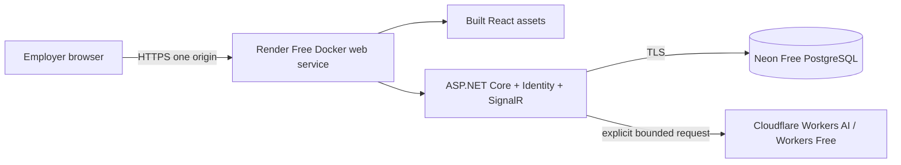

# Future zero-additional-cost deployment assessment

**Preparation only — nothing is deployed by M6.** FleetFlow currently remains local. This guide is a reviewed candidate architecture, not a promise of permanent free availability or an already hardened production deployment. Provider conditions were checked on **2026-11-08**; verify them again in your own accounts before activation. Stop if any step requires a credit card, billing activation, prepaid credits or a paid plan.

## Candidate architecture



The application and inference run independently of a developer's computer. React and API share an origin; cookies/CSRF and SignalR do not need broad CORS. Use provider-supplied HTTPS hostnames: buying a domain is optional and unnecessary. No Worker script, Gateway, Ollama, background worker, external paid monitoring or keep-alive traffic is required.

`Dockerfile.web` packages the actual React production build into ASP.NET `wwwroot`, runs non-root, enables known SPA route fallbacks and accepts a provider `PORT`. It is an optional packaging artifact, **not** deployment automation. Normal local Compose still uses the split Vite/API arrangement. Build it locally with:

```sh
docker build -f Dockerfile.web -t fleetflow-web:local .
```

A successful image build does not verify hosted networking, TLS, secrets, database permissions or production access control configuration.

## Free services and trade-offs

| Component | Official basis and current limits | Manual checks / limitations |
| --- | --- | --- |
| Web | [Render Free services](https://render.com/docs/free), [first deployment](https://render.com/docs/your-first-deploy): free web services support Docker; 750 free instance hours/workspace/month; idle services sleep after 15 minutes | Verify a genuinely free/no-card account and instance type. Review workspace bandwidth/build-minute quotas and no-payment suspension behavior. Cold starts delay UI/API/SignalR. A continuously active WebSocket may keep a service active; hours still apply. Do not generate keep-alive traffic. Local filesystem is ephemeral. |
| Database | [Neon plans](https://neon.com/docs/introduction/plans): Free currently includes 100 CU-hours/project/month, 1 GB/project storage (20 GB across projects), 5 GB public egress and scale-to-zero after five idle minutes | Verify actual dashboard limits, supported PostgreSQL version/extensions and region. Use a persistent root branch, not an expiring preview branch. Keep within compute/storage/egress caps; expect suspension/limits and cold connection latency. Free persistence is not a permanent-service or backup guarantee. |
| Inference | [Cloudflare pricing](https://developers.cloudflare.com/workers-ai/platform/pricing/) and [free model confirmation](https://developers.cloudflare.com/changelog/post/2026-07-28-models-require-workers-paid/): Workers Free, GLM-4.7-Flash, 10,000 Neurons/account/UTC day | Never enable Workers Paid, paid-only models, automatic upgrades, AI Gateway credits or paid Gateway inference. Verify account/terms/fictional dataset/model manually, renew FleetFlow's attestation at most weekly, retain strict budgets. Exhaustion means deterministic-only mode. |

These are independent providers with shared/account-level limits. A free quota can change, be withdrawn, sleep, throttle or suspend. No SLA or uninterrupted employer-demo availability is promised. Prefer a minimal dataset and a single small service; benchmark nothing with invented metrics. Do not solve a free limit by adding paid resources.

**Do not use Render Free PostgreSQL for this demo:** its documented free database expires after 30 days. Ephemeral SQLite/container storage and temporary trial databases also do not meet the persistence requirement. Neon root-branch storage is the durable candidate, subject to the provider's actual retention/account terms. If Neon introduces mandatory expiry/payment for your selected configuration, stop and reassess before deploying.

## Mandatory manual prerequisites before any deployment

1. Obtain separate explicit approval to deploy; M6 provides none. Verify all three current free plans without adding payment methods or enabling credits. Set no automatic upgrade, inspect any default paid extras and disable them. If signup requires billing, stop.
2. Read the Cloudflare/model [setup, EEA and privacy assessment](docs/insights.md#cloudflare-setup--manual-optional-no-paid-activation), provider AUP/terms/DPA and hosting/database data-location conditions. No EEA paid-only inference condition was found in the reviewed Cloudflare terms; that is not legal clearance or EU-only residency. Publish appropriate privacy, fictional-data and AI notices before public access.
3. Finish the existing [security deployment blockers](docs/security.md) and [Identity limitations](docs/authentication.md). In particular, define a safe one-time administrator bootstrap/account recovery process; Development seeding must **not** be enabled publicly. Create controlled demo accounts and keep user administration private. Public self-registration stays disabled.
4. Configure Production, precise `AllowedHosts`, HTTPS-only cookies, TLS and trusted forwarded headers for the actual reverse proxy. The current SignalR origin guard compares request scheme/host: TLS termination must be tested with a narrowly trusted proxy/origin configuration. **M6 has not implemented or verified Render proxy trust.** Never trust arbitrary forwarding headers, add wildcard CORS or disable CSRF to make it work.
5. Use a least-privilege application PostgreSQL role over verified TLS; isolate migration ownership. Configure the real connection string in hosting secrets, never in an image, README or frontend. Verify Npgsql/Neon connection/pooling behavior and PostgreSQL-version migration compatibility on a disposable branch before production data.
6. Apply all versioned migrations using a reviewed release/migration procedure. The current `--migrate`, seed and demo-user CLI deliberately require Development; they are **not a production migration/bootstrap workflow**. Design and verify that separate procedure before deployment. Preserve the root branch/data; never run reset-demo against hosted data.
7. Persist and encrypt Data Protection keys appropriately outside the ephemeral web filesystem. The existing PostgreSQL key store persists keys but development does not encrypt them at rest at the application layer. Arrange a no-cost supported protection/rotation approach or explicitly reassess this blocker. Restarts/scale changes must preserve expected cookie validation; test revoke/logout/expiry over the actual proxy.
8. Configure a single API instance initially. In-memory login rate limits and SignalR connections are instance-local. PostgreSQL AI budget locks are shared/persistent, but SignalR has no distributed backplane/outbox. Sleep/restart can lose hints; REST reconciliation recovers current state, not missed event delivery. Do not claim multi-instance reliability.
9. Keep `AI_ENABLED=false` initially. After verifying an entirely fictional hosted dataset and free Cloudflare account, set server-only credentials, model, explicitly allowlisted demo Identity IDs and the expiring review flags. No live call is needed during deployment. A deliberate later user action is the only permitted inference trigger.
10. Verify HTTPS browser behavior, origin/CSRF checks, role permissions, account deactivation, quota exhaustion, cold starts, data persistence and recovery. Run hosted CI for the exact revision. Add safe operational log retention, dependency updates, abuse controls and independently stored backups with a tested restore plan. Verify any backup storage/export path is free; do not silently purchase one.

## Cost and privacy risk

FleetFlow has no billing API, automatic provider switch, paid-model fallback or subscription-upgrade code. Its application caps are 3 attempts/user/day, 20 global/day, one global in-flight request and 500 output tokens; reservations and provider-exhaustion cooldowns survive restarts. These protect usage but **cannot prove account-level zero cost**. Another app can consume the account quota, a human can upgrade a plan, and providers can change terms or quotas. The application cannot query/verify your actual billing plan; manual verification and expiring enablement are deliberate safeguards.

Do not provide a real Cloudflare token to CI. Never upload an actual `.env`, password, connection string or authenticated trace. Cloudflare processes only minimized fictional facts when explicitly requested, but cross-border processing/metadata and provider terms still require review. If any required service ceases to be usable free without billing, disable inference or suspend the demo and explain the limit rather than upgrading automatically.

## Verification status

M6 verifies the local Docker packaging, database migration and fake-provider browser journeys; see [the M6 verification report](docs/m6-verification.md). No Render, Neon or Cloudflare account was created, no billing enabled, no real inference requested and no public service deployed. Provisioning, provider-side configuration, HTTPS/proxy hardening and hosted runtime behavior remain future manual work.
