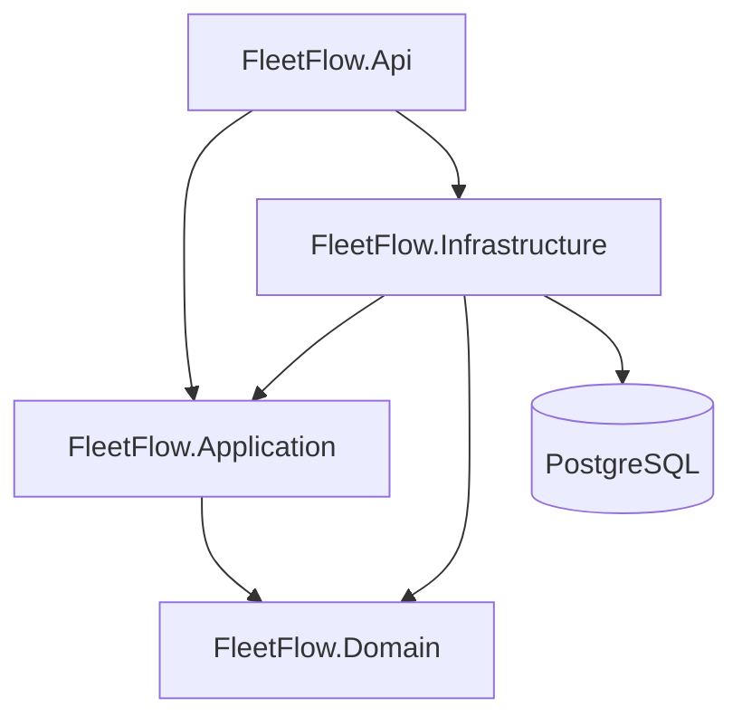
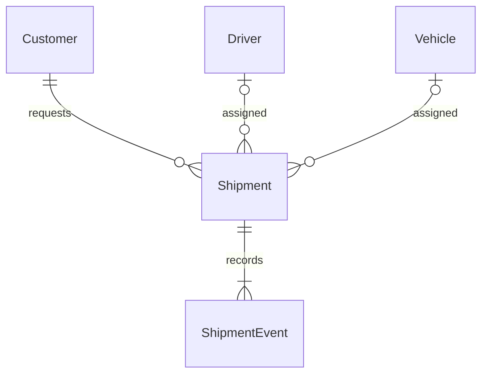

# FleetFlow architecture

FleetFlow is an independently designed personal portfolio project for logistics operations. M2 exposes the M1 domain and PostgreSQL persistence through versioned controller endpoints. Dashboard statistics are SQL-backed. M3 adds a responsive, real-data operations frontend; Identity authentication is added in M5a.

## Backend boundaries

Arrows represent project references. API references Infrastructure to compose dependency injection at startup. Controllers handle HTTP; Application orchestrates use cases; Domain owns business invariants; Infrastructure implements persistence. Domain contains validated entities and rules. Application contains shipment command orchestration and a focused persistence interface.

Use controllers consistently for application HTTP endpoints. Health endpoints also use a controller. First-party ASP.NET Core OpenAPI is exposed only in Development. No generic repository, mediator framework, event bus, or custom unit-of-work abstraction is introduced. EF Core's DbContext provides change tracking and the persistence unit of work. DTOs remain separate from entities.

The DbContext uses EF Core 10 and the Npgsql 10 provider. A health check exercises its actual PostgreSQL connection; it does not create a schema. M1 provides an initial versioned migration and explicit development-only fictional seeds. Never use EnsureCreated as a substitute for migrations. Integration tests use isolated real PostgreSQL 18 containers, independent of the development database.

## HTTP foundation

| Route | Availability | Behavior |
| --- | --- | --- |
| `GET /health` | All environments | Liveness, 200 with `{"status":"Healthy"}`; no database dependency |
| `GET /health/ready` | All environments | Database connectivity, 200 when healthy; safe ProblemDetails with 503 otherwise |
| `GET /openapi/v1.json` | Development only | Generated API contract |

Problems include a machine-readable `code` and request `traceId`. Unexpected exceptions receive a generic 500 response; connection credentials and exception details are never returned. Business endpoints use `/api/v1` and explicit status/assignment commands. Dedicated HTTP DTOs map to application services/read models; EF entities never form the API contract. No CORS policy is needed locally: Vite proxies same-origin requests to the API.

## Frontend

React Router defines lazy-loaded dashboard, shipment list/new/detail/edit, customer, driver and vehicle pages. A persistent responsive workspace shell supplies navigation, search and readiness feedback. Page-level Suspense and an error boundary provide recoverable loading/render failures.

`frontend/src/features/` owns feature pages, shipment forms, assignment/status dialogs and timeline. `components/ui` supplies the existing shadcn-style Button and Radix Dialog; `components/shared` supplies fields, states, pagination, tables/directory composition and page framing. `lib` owns typed HTTP transport, query helpers, error mapping and date conversion. No global client-state store is introduced.

`types/api.generated.ts` is generated from the actual Development OpenAPI document. Public aliases and Zod response schemas at the transport boundary detect incompatible responses at runtime. React Hook Form/Zod handle input ergonomics; domain and transaction rules remain authoritative in .NET. See [the M3 guide](m3-verification.md) for regeneration and timezone decisions.

TanStack Query owns all server state. Lists use server-side filters and bounded pagination; shipment filters/paging live in the URL. Mutations invalidate related shipment/history/dashboard/resource queries. Shipment writes keep the version captured when editing began; background fetches do not silently advance it. HTTP 409 `stale_version` blocks resubmission until an explicit successful refresh. No optimistic mutation or automatic write retry can overwrite another operator's changes.

All schedule inputs and displays use Europe/Vienna. Temporal converts to UTC, rejects ambiguous/nonexistent clock-change times, and preserves unchanged timestamps at their original precision. The API continues to store UTC instants and PostgreSQL decimal weights. Production UI contains no mock data.

## Development and versioning

PostgreSQL and the non-root API run in Docker; Vite runs locally. Published ports bind to loopback. PostgreSQL 18 stores data in a named volume mounted at `/var/lib/postgresql`, following the image's version-specific layout. Identity protects the workspace in Development too; deployment hardening is still incomplete.

`global.json` pins the stable .NET 10 SDK and selects Microsoft Testing Platform for xUnit. Central NuGet versions and committed package lockfiles keep dependencies coherent. Node is declared in `.nvmrc`; npm uses exact direct versions and a committed lockfile. Container tags are explicit; upgrades should update the pins and rerun the same verification commands.

## Domain relationships

Each shipment has one required customer and an optional driver/vehicle pair. Addresses are EF complex values stored as columns on Shipments. All foreign keys restrict deletion; history is immutable. Database indexes support shipment numbers, customers, resource lookups, status/deadline, creation order, and shipment/event time.

## Current milestone boundary

M1 implements entities, migration, constraints, fictional seeds, domain/application validation, transactional event history, and PostgreSQL concurrency tests. Shipment versions protect stale updates; row locks coordinate resource reservations across shipments. See [ADR 0002](decisions/0002-domain-persistence.md) for semantics and trade-offs.

M2 adds read projections, SQL dashboard aggregates, bounded pagination, API contracts and HTTP/PostgreSQL tests. Fleet updates share the reservation locks and transaction implementation. See [ADR 0003](decisions/0003-rest-api.md) and the [API guide](api/v1.md). M3 consumes this contract without backend changes and verifies complete workflows through HTTP and the browser against a disposable Docker stack. The original health/readiness functionality remains available in the top bar. M4 adds the quality checks and portfolio documentation described below.

## M4 quality boundary

M4 retains the modular monolith and existing wire contracts. It adds Release/coverage/real-PostgreSQL checks, least-privilege GitHub Actions configuration, safe application error-log metadata, non-cacheable/nosniff API responses, hardened local API container settings, query/error recovery tests and reproducible browser/accessibility verification. PostgreSQL concurrency failures are recognized through provider/EF wrapper chains and remain explicit 409 conflicts with atomic rollback.

Frontend changes address actual contrast, label/focus, pagination recovery and ambiguous-write issues. Code remains feature-based; no global client-state store, new business endpoint or architectural framework was introduced. See the [M4 review](m4-review.md), [security review](security.md), [CI design](ci.md) and [actual verification report](m4-verification.md). Authentication, SignalR, AI and public deployment remain outside M4.

## M5a identity boundary

Infrastructure now owns Identity users/EF stores, additive schema, administrative transactions and Development-only user provisioning. API owns cookie authentication, CSRF filters and authorization policies. User administration controllers remain thin; shipment services and transaction rules are unchanged. Data Protection keys persist in PostgreSQL for restart continuity. React has a separate auth feature with guarded routes, same-account draft recovery and role-aware actions. See [authentication](authentication.md) and [M5a verification](m5a-verification.md). SignalR remains outside this milestone.

## M5b real-time boundary

The existing EF transaction captures minimal change hints and invokes an Application notification port only after commit. The API implements it through a typed SignalR Hub; Domain and REST behavior remain unchanged. Notification failures cannot undo persistence. An instance-local connection registry revalidates Identity accounts/stamps/expiry before broadcast and every five seconds. React's separate realtime feature invalidates TanStack queries, retains form snapshots, recovers after reconnect and periodically reconciles best-effort delivery through REST. No database schema changes or additional services are needed. See [real-time contract and security](realtime.md) and [M5b verification](m5b-verification.md).
