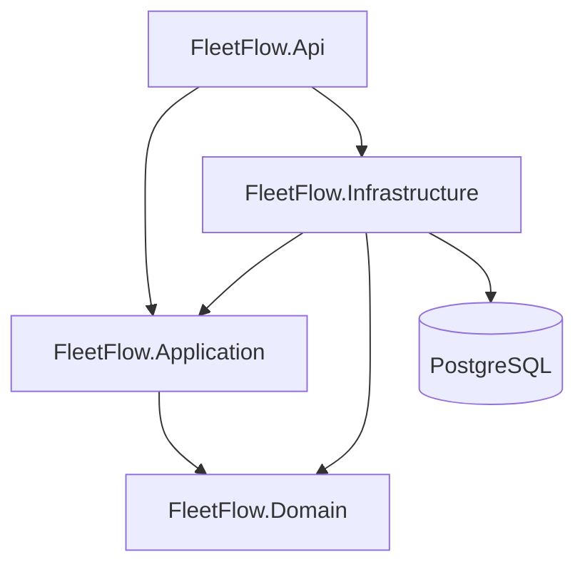
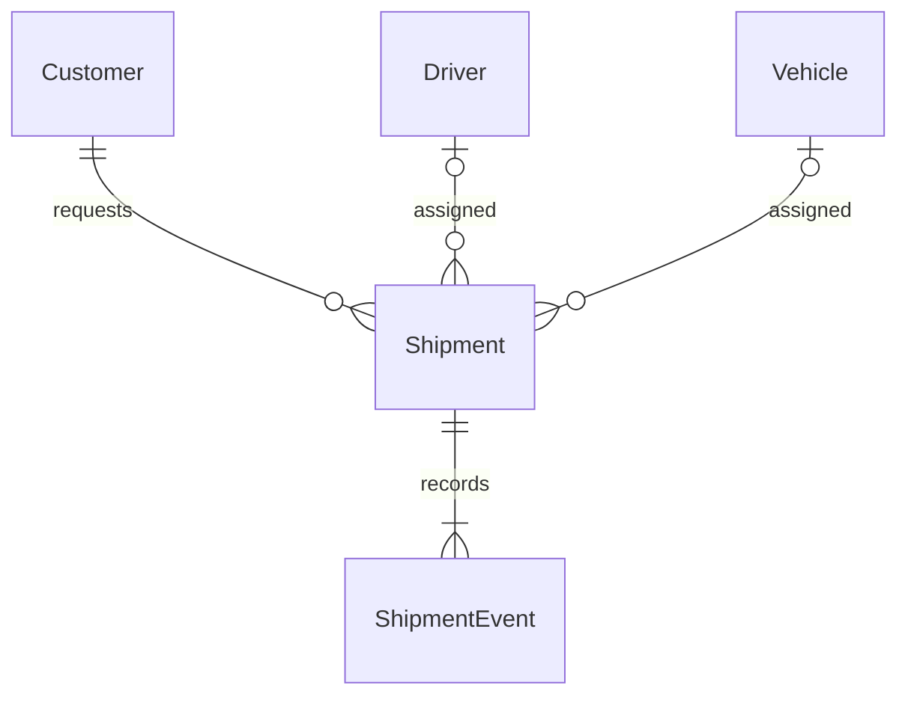

# FleetFlow architecture

FleetFlow is an independently designed personal portfolio project for logistics operations. M1 adds the domain model, PostgreSQL schema and application business logic to the M0 infrastructure. Business HTTP endpoints, authentication, and dashboard metrics are not exposed yet.

## Backend boundaries

Arrows represent project references. API references Infrastructure to compose dependency injection at startup. Controllers handle HTTP; Application will orchestrate use cases; Domain will own business invariants; Infrastructure implements persistence. Domain contains validated entities and rules. Application contains shipment command orchestration and a focused persistence interface.

Use controllers consistently for application HTTP endpoints. Health endpoints also use a controller. First-party ASP.NET Core OpenAPI is exposed only in Development. No generic repository, mediator framework, event bus, or custom unit-of-work abstraction is introduced. EF Core's DbContext provides change tracking and the persistence unit of work. DTOs will be separate from entities.

The DbContext uses EF Core 10 and the Npgsql 10 provider. A health check exercises its actual PostgreSQL connection; it does not create a schema. M1 provides an initial versioned migration and explicit development-only fictional seeds. Never use EnsureCreated as a substitute for migrations. Integration tests use isolated real PostgreSQL 18 containers, independent of the development database.

## HTTP foundation

| Route | Availability | Behavior |
| --- | --- | --- |
| `GET /health` | All environments | Liveness, 200 with `{"status":"Healthy"}`; no database dependency |
| `GET /health/ready` | All environments | Database connectivity, 200 when healthy; safe ProblemDetails with 503 otherwise |
| `GET /openapi/v1.json` | Development only | Generated API contract |

Problems include a machine-readable `code` and request `traceId`. Unexpected exceptions receive a generic 500 response; connection credentials and exception details are never returned. Future business endpoints use `/api/v1` and explicit status/assignment commands. No CORS policy is needed locally: Vite proxies same-origin requests to the API.

## Frontend

React Router and TanStack Query providers are registered at the application boundary. TanStack Query owns the readiness request and retry state. The English M0 screen shows only actual infrastructure connectivity, with loading, error, retry, and success states. No fake shipments or metrics are displayed.

Tailwind CSS and a shadcn/ui-compatible Radix button establish the UI foundation. `components.json` and the `@/` alias support subsequent shadcn components. Features will be organized by dashboard, shipments, customers, drivers, and vehicles when implemented. Forms and generated business API types belong to later milestones.

## Development and versioning

PostgreSQL and the non-root API run in Docker; Vite runs locally. Published ports bind to loopback. PostgreSQL 18 stores data in a named volume mounted at `/var/lib/postgresql`, following the image's version-specific layout. Development has no authentication and is not suitable for public deployment.

`global.json` pins the stable .NET 10 SDK and selects Microsoft Testing Platform for xUnit. Central NuGet versions and committed package lockfiles keep dependencies coherent. Node is declared in `.nvmrc`; npm uses exact direct versions and a committed lockfile. Container tags are explicit; upgrades should update the pins and rerun the same verification commands.

## Domain relationships

Each shipment has one required customer and an optional driver/vehicle pair. Addresses are EF complex values stored as columns on Shipments. All foreign keys restrict deletion; history is immutable. Database indexes support shipment numbers, customers, resource lookups, status/deadline, creation order, and shipment/event time.

## M1 and next boundary

M1 implements entities, migration, constraints, fictional seeds, domain/application validation, transactional event history, and PostgreSQL concurrency tests. Shipment versions protect stale updates; row locks coordinate resource reservations across shipments. See [ADR 0002](decisions/0002-domain-persistence.md) for semantics and trade-offs.

HTTP business endpoints follow in M2, frontend workflows in M3, and CI/portfolio packaging in M4. The existing M0 screen and health routes remain unchanged.
