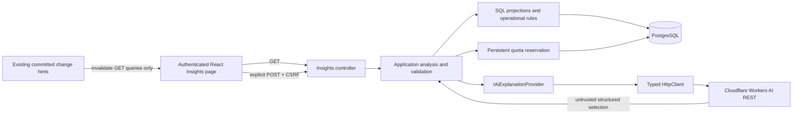

# Operational insights and on-demand AI

M6 adds read-only logistics intelligence. Deterministic analysis works with PostgreSQL alone; external inference is optional and disabled by default. No Worker script, AI Gateway, local model server, background generation or automatic provider fallback is involved.

## Architecture and trust boundaries



`OperationalRules` contains pure time-dependent expressions and trusted explanations. Infrastructure applies those expressions in PostgreSQL, including counts, filtering, stable priority ordering and pagination. `TimeProvider` supplies one UTC instant per snapshot; a repeatable-read transaction keeps its aggregates and six-finding sample coherent. No dashboard operation loads all shipments into memory.

The Application provider port has no Cloudflare dependency. Infrastructure supplies the direct HTTP implementation. The API owns cookie/role policies, CSRF, paging, binding and safe ProblemDetails. No business mutation service is exposed to the model.

## Verified findings

| Type | Severity | Recorded evidence |
| --- | --- | --- |
| Overdue | High | Draft/Planned delivery deadline is strictly before now |
| InTransitOverdue | Critical | InTransit delivery deadline is strictly before now |
| DueSoon | Medium | Nonterminal delivery deadline is from now through now + 24 hours, inclusive |
| PickupWindowOpen | Low | Planned pickup window has started; this does **not** prove late pickup |
| UnassignedDraft | Medium | Draft pickup is within 24 hours or already started, with a driver/vehicle missing |
| AssignmentRequiresReview | High | Draft/Planned selected resources no longer satisfy current eligibility/capacity |

Delivered and Cancelled orders produce no findings. InTransitOverdue replaces, rather than duplicates, generic Overdue. A shipment can have several different findings; total findings and distinct affected shipments are intentionally separate. No finding implies actual location, weather, traffic, telemetry, an unknown delay cause or a predicted arrival time.

Finding IDs are stable `shipment-guid:type` values. Evidence includes the observed status/version, UTC schedule and resource-eligibility flags. Recommended actions are explicitly suggestions. Findings are derived on demand, not stored as shipment events. Existing shipment validation and concurrency rules remain authoritative.

## Grounded AI output

The model receives at most six prioritized findings and selects up to three supported recommendations. It assembles a short natural-language summary from one or two **exact, server-approved fact sentences**. It cannot introduce free-form facts or arbitrary advice. This controlled-language design intentionally favors verifiability over unrestricted conversational prose.

Inputs include opaque finding IDs, enum types/severity, UTC dates, versions and eligibility booleans. Customer/contact/driver names, addresses, cities, shipment numbers and cargo descriptions are excluded. Human-readable shipment numbers are joined back on the server after validation. Database text is never treated as an instruction. The system prompt separates data and instructions; stronger defenses are minimizing input and rejecting output outside the exact schema/allowlists.

Validation rejects unknown/duplicate JSON keys, unknown IDs, unsupported actions, duplicate choices, invalid order/severity, unapproved summary text, changed models, tool calls, truncation and oversized responses. Unvalidated text is never returned. Model selections never create shipments, assignments, events or status changes. Only the technical usage ledger is written.

The summary describes the bounded **sample**, not every finding. The UI shows sample/total counts, evidence links, generation time, a cache label and a warning if the snapshot changed. The AI does not infer delay causes or ETAs. AI selection is assistance for a human dispatcher, not an operational decision.

## HTTP contract

All routes use `/api/v1/insights`; see [API v1](api/v1.md#m6-operational-insights).

- `GET /` returns server-paged findings (`page`, `pageSize`, optional `shipmentId`).
- `GET /summary` returns real counts, `asOfUtc`, sample size and a snapshot fingerprint.
- `GET /ai-availability` reports configuration/account eligibility and persisted budgets. No inference occurs.
- `POST /ai-analysis` accepts `{ "snapshotFingerprint": "<64 lowercase SHA-256 characters from summary>" }`. It requires an explicit authorized account, current Identity cookie and `X-CSRF-TOKEN`.

Admin, Dispatcher and Viewer may read deterministic insights. **AI generation additionally requires an explicit real Identity user ID in `AI_ALLOWED_USER_IDS`**, regardless of role. An approved Viewer still cannot mutate logistics data. Administrators do not receive unlimited or implicit AI privileges.

Typical problems: 400 malformed request/CSRF, 401 expired or absent session, 403 not allowlisted, 409 `insights_changed`, 422 `ai_no_findings`/`ai_input_too_large`, 429 local budget/in-flight conflict, and 503 disabled/unverified/provider failure. No credentials, provider response body or infrastructure exception is exposed.

## Cost controls and persistence

| Setting | Default | Supported ceiling |
| --- | --- | --- |
| `AI_USER_DAILY_LIMIT` | 3 attempts | 3 |
| `AI_GLOBAL_DAILY_LIMIT` | 20 attempts | 20 |
| Concurrent generation | 1 globally | 1 (also enforces 1 per user) |
| `AI_MAX_OUTPUT_TOKENS` | 500 | 500 |
| `AI_MAX_INPUT_BYTES` | 6000 | 8000, minimum 512 |
| `AI_TIMEOUT_SECONDS` | 10 | 15 |

Limits can be reduced. Unsupported configuration disables inference rather than expanding budgets. UTF-8 prompt data is bounded; the fixed system instruction/schema add a small bounded overhead. Output includes a 32 KiB transport bound and strict application validation. Reasoning is disabled with the model's supported `enable_thinking=false` template option. The output-token request bound remains 500; a future provider change cannot be treated as a billing guarantee.

`AddAiUsageLedger` adds `AiAttempts` with an Identity FK, UTC day, start/completion/lease, model, fingerprint, validated selection/cache expiry and safe failure code. No raw prompts, model prose or API tokens are persisted. Existing logistics and Identity rows are preserved. A PostgreSQL transaction/advisory lock atomically reserves daily capacity and an in-flight lease **before** the network request. All app instances must share this database. Restarting does not reset quotas. Failed, cancelled, timed-out and abandoned attempts remain counted; provider receipt cannot be proven after a network failure. Leases expire safely; usage older than 30 days is pruned during reservations.

An unchanged fingerprint/model/user reuses a validated result for five minutes without a new provider request. Fingerprints include current counts and sampled fact versions/evidence, not the changing observation timestamp. A changed non-sampled detail can leave the same bounded analysis reusable. There are no HTTP inference retries, automatic model migrations or provider fallbacks.

Cloudflare error `3036` (or an unknown HTTP 429) persistently blocks further inference until the next UTC day. Capacity error `3040` and other failures impose a one-minute global cooldown. A paid-plan-required `5035` is rejected, blocked until the next UTC day and reported for owner review; no upgrade/credits/fallback happens. Deterministic GETs continue in all these states. GET availability is advisory; only the transactional POST reservation is authoritative.

These safeguards **do not guarantee** staying below the provider's quota: other applications share the account allocation, usage units differ from tokens, and pricing/terms may change. Use a dedicated Workers Free account, never enable paid billing or prepaid credits, monitor its dashboard manually and disable inference if eligibility changes.

## Cloudflare setup — manual, optional, no paid activation

Reviewed against official documentation on **2026-11-08**:

- [`@cf/zai-org/glm-4.7-flash`](https://developers.cloudflare.com/workers-ai/models/glm-4.7-flash/) is explicitly listed among [models remaining available on Workers Free](https://developers.cloudflare.com/changelog/post/2026-07-28-models-require-workers-paid/).
- [Workers AI pricing](https://developers.cloudflare.com/workers-ai/platform/pricing/) currently provides 10,000 Neurons/account/day, resetting at 00:00 UTC. Workers Free fails further operations after its allocation; Workers Paid and prepaid Gateway credits are outside this project.
- Cloudflare advertises [free signup without a credit card](https://www.cloudflare.com/products/workers-ai/). If your account flow requires a card, credits, Workers Paid or an upgrade, **stop and leave AI disabled**.
- The publisher's [GLM-4.7-Flash model card](https://huggingface.co/zai-org/GLM-4.7-Flash) identifies MIT licensing. FleetFlow does not redistribute model weights. Review publisher/model terms again before activation.
- Review [Cloudflare terms](https://www.cloudflare.com/terms/), [developer platform / Workers AI terms](https://www.cloudflare.com/service-specific-terms-developer-platform/) and [data usage](https://developers.cloudflare.com/workers-ai/platform/data-usage/). No EEA paid-only restriction analogous to the rejected provider was found in those reviewed terms. This is an implementation assessment, not a legal guarantee or a claim of EU-only processing. Public access still needs privacy/abuse notices and an owner review for Austria/EEA.

Manual procedure:

1. Create/verify a **Workers Free** account without payment details. Check that there is no Workers Paid plan, prepaid inference balance or automatic upgrade. Verify the exact model, quotas, terms, fictional dataset and intended EEA audience yourself. No account was created or enabled by this milestone.
2. Copy the Account ID from the account dashboard. Create an account-scoped API token following [the official REST guide](https://developers.cloudflare.com/workers-ai/get-started/rest-api/), with the documented Workers AI Read/Edit permissions, restricted to the intended account. Use the narrowest supported scope and an expiry; never a global API key.
3. Put the token only in ignored root `.env` for local Compose, process environment or ASP.NET development secrets. Never use `VITE_*`, browser storage, screenshots, checked-in JSON, shell history containing a token or CI artifacts. Do not run a live-inference smoke test unless you explicitly intend to spend free quota.
4. Read the real user IDs from the authenticated `/api/v1/auth/me` response or Admin users screen/API. Allowlist only controlled fictional-demo accounts. Configure `.env` using the names below, with your actual values kept private:

```dotenv
AI_ENABLED=true
AI_PROVIDER=cloudflare
CLOUDFLARE_ACCOUNT_ID=<your-account-id>
CLOUDFLARE_API_TOKEN=<your-server-only-token>
CLOUDFLARE_AI_MODEL=@cf/zai-org/glm-4.7-flash
AI_ALLOWED_USER_IDS=<approved-identity-guid>,<another-approved-guid>
AI_FREE_TIER_VERIFIED=true
AI_FREE_TIER_VERIFIED_MODEL=@cf/zai-org/glm-4.7-flash
AI_FREE_TIER_VERIFIED_UNTIL_UTC=<review-expiry-in-UTC-within-seven-days>
AI_USAGE_TERMS_VERIFIED=true
AI_FICTIONAL_DATA_CONFIRMED=true
```

5. Set a literal UTC expiry, such as an owner-chosen date/time ending `Z`, after reviewing the account. It must be in the future and at most seven days away. Never auto-renew this attestation in a script. Defaults in `.env.example` remain disabled/unverified.
6. Recreate the local API (`docker compose -p fleetflow up -d --build api`). Settings are read at startup. Sign in, open **AI Insights**, inspect availability and deliberately click **Generate AI Analysis** only when desired. A GET or SignalR update never spends inference quota.

`AI_ENABLED=false`, absent credentials, expired review or an empty allowlist leaves all deterministic functions usable. No account/key is required to build, test or use those functions. The application cannot inspect whether your external account is actually on Workers Free: the owner attestation is a necessary manual control. A later manual change to paid billing would invalidate the zero-cost assumption even with application limits.

## Privacy and security boundaries

Only fictional logistics datasets may enable external inference. Minimization reduces exposure but opaque IDs, dates and operational patterns still leave your server. Cloudflare documents no training on customer content and zero data retention for supported stateless inference, subject to its documented exceptions/metadata handling; this is not a promise of no processing, no metadata or EEA-only residency. Do not send real customer/employee data. Account credentials and AI eligibility belong to the server.

The typed client uses fixed HTTPS host/model, an Authorization header, no redirects/cookies/tools/Gateway and suppressed HttpClient request logging. Provider errors become fixed machine-readable failures. Current Identity session validation, logout, deactivation, request rate limits, CSRF and same-origin development proxy remain active. Long-running requests still consume a reservation if the user disconnects. Existing public-deployment hardening blockers are listed in [security](security.md) and the [future zero-cost guide](../ZERO_COST_DEPLOYMENT.md).

## Tests and local development

Run the normal [test commands](testing.md). Unit tests use a fake HTTP handler and deterministic provider. PostgreSQL integration tests cover real SQL rules, UTC boundaries, persisted quotas, concurrent reservations, failures, schema/data preservation and HTTP authorization/CSRF. Browser tests use a separate Development-only test executable with the real API/Identity/PostgreSQL and only the provider replaced. It rejects real Cloudflare credentials and is absent from production images. CI requires no external AI key or inference service.

React uses generated OpenAPI types plus Zod, TanStack Query for GET state and an explicit non-retrying mutation for generation. Existing shipment/resource notifications invalidate insight GET caches, including reconnect recovery. They never call the provider. Shipment edit snapshots and explicit version-conflict recovery remain unchanged.
