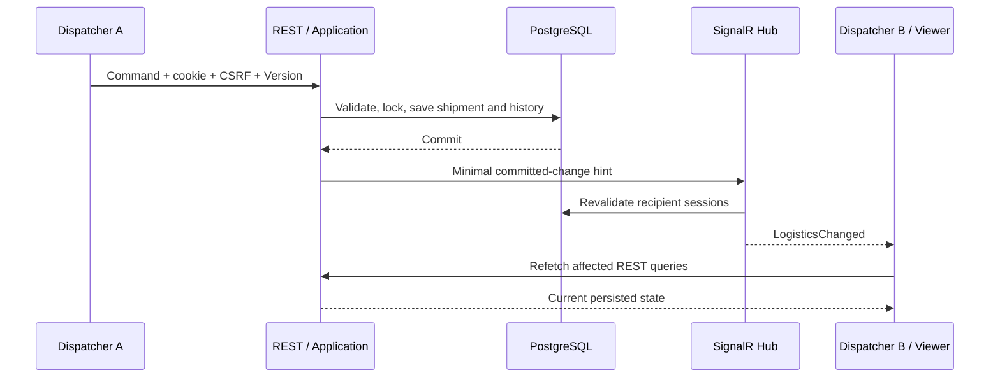

# Real-time logistics — M5b

FleetFlow adds authenticated SignalR invalidation hints to its existing modular monolith. The REST contract, PostgreSQL transactions, reservation locks, immutable shipment history and expected-Version checks are unchanged. There are no business mutation methods on the Hub.



## Boundaries and delivery

`Application/Realtime` defines a small notification record and transport port. Infrastructure's existing `EfTransaction` captures added shipment history and changed resources, saves them, commits, then calls the port. The API implements it with `IHubContext<LogisticsHub, ILogisticsClient>`. Domain entities have no SignalR dependency. Infrastructure can still run without the Hub, including the development CLI.

A failed validation, concurrency check, SaveChanges or commit emits nothing. Cancellation of the original request after commit does not cancel the committed result. Delivery gets an independent two-second budget; errors are safely logged and cannot undo a commit or turn a saved command into an HTTP failure. This is **best-effort invalidation**, not guaranteed message delivery: a process crash between commit and publication can lose a hint. No outbox, durable event bus or delivery acknowledgement is claimed. Successful shipment transitions still create exactly one persisted event, independently of socket availability.

## Endpoint and payload

Endpoint: `/hubs/logistics`, standard SignalR JSON protocol. Client event: `LogisticsChanged`. `Ready` is a connection-registration acknowledgement, not a business command. This separate transport is documented here; the existing Development-only OpenAPI continues to describe REST.

```json
{
  "eventId": "0199f910-9270-7000-8000-000000000001",
  "entityType": "shipment",
  "entityId": "0199f910-9270-7000-8000-000000000002",
  "eventType": "ShipmentStatusChanged",
  "version": 4,
  "timestampUtc": "2026-11-08T12:30:00Z"
}
```

| Entity | Event types | Version |
| --- | --- | --- |
| shipment | ShipmentCreated, ShipmentUpdated, ShipmentAssigned, ShipmentStatusChanged, ShipmentCancelled | Persisted shipment Version |
| driver | driverCreated, driverUpdated | null |
| vehicle | vehicleCreated, vehicleUpdated | null |
| customer | customerCreated | null |

Shipment event IDs reuse the committed history ID. Resource hints get unique IDs; these entities have no existing concurrency token, so a fabricated version would be misleading. Null explicitly represents that distinction. Payloads contain no customer contact details, addresses, audit actors, messages, passwords, security stamps or cookies. Resource changes also invalidate shipment projections that embed resource names. All three roles can read the same logistics dataset in this single-organization application; this is not a multi-tenant authorization design.

## Authentication and browser security

The Hub requires `LogisticsRead` (Admin, Dispatcher, Viewer) and uses the existing Identity HttpOnly cookie. Every negotiate/transport HTTP request passes normal authentication. Unsafe Hub HTTP methods, including negotiation POST and Long Polling POST/DELETE, require the same synchronizer CSRF header as REST. Browser WebSocket APIs cannot set that custom header: upgrade GETs instead require an Origin, checked against the request's exact origin or four explicit Development Vite origins (`localhost` / `127.0.0.1`, ports 5173/5174). Foreign origins and `null` are rejected. CORS is not broadened. Host restrictions, Strict SameSite cookies, role policies and REST CSRF remain in place. Origin is a browser boundary, not an identity credential.

`CloseOnAuthenticationExpiration` closes transport sessions at their ticket deadline. SignalR otherwise caches its principal: ordinary cookie validation alone would leave an established socket authorized after account deactivation. The instance-local registry therefore stores only connection ID, user ID, security stamp, expiry and an abort callback. It queries current active accounts, stamps and read-role membership **before every broadcast**, in bounded batches, and aborts invalid recipients. A five-second background sweep also closes idle revoked sockets. Logout/password changes rotate Identity stamps as before; logout therefore revokes other sessions for the same account too. Accounts changing in the tiny interval between validation and send can have an already-in-flight hint; the payload is deliberately minimal and every authoritative REST read reauthenticates. A database outage prevents verification/delivery; it does not bypass validation.

Detailed Hub errors and client transport logging are disabled. Existing ASP.NET logging restrictions prevent transport connection tokens in ordinary request logs. Keep local development on loopback. Authentication is not public deployment approval.

## React behavior

`features/realtime` owns connection lifecycle, payload validation, bounded deduplication and query invalidation. The official Microsoft client starts only after session restoration/login and stops on logout, account changes, session locking or component disposal. Its standard automatic reconnect delays are 0/2/10/30 seconds; failed initial starts or exhausted reconnects retry at 2/5/10/30 seconds with a 30-second cap. Each newly built connection obtains current CSRF configuration. Authenticated-session checks at connection readiness, after disconnect and during periodic reconciliation feed the existing expiry modal rather than discarding unsaved forms. If another tab replaces the shared cookie with a different account, the old workspace locks and disconnects; only explicit sign-in adopts another account. Its cached CSRF token is cleared, and pending checks are aborted when the workspace is disposed.

The subtle Connected / Reconnecting / Disconnected indicator exposes an accessible label. REST remains usable when sockets fail; disconnected active queries reconcile every 30 seconds; even connected clients reconcile every minute to recover silently lost best-effort hints. Initial connection and every successful reconnect invalidate all logistics caches to recover missed messages. Messages invalidate dashboard/list/detail/history or resource keys; they never patch records from payloads. Shipment versions suppress duplicate/older hints; resource hints deduplicate by event ID and accept delayed hints without comparing timestamps. Both memories are bounded to 1,000 entries; an evicted duplicate merely causes a harmless REST refetch.

Open shipment, status, assignment and resource forms retain captured baseline data. Background refetches do not reset their inputs or advance their expected Version. A conflicting save still returns 409 and requires deliberate reload/discard. No force overwrite or full-page reload is performed.

Vite proxies `/hubs` with WebSocket support to `API_PROXY_TARGET`, alongside existing REST routes. Use the documented same-origin browser URL; do not point the browser client at an arbitrary cross-origin API. After changing Vite configuration, restart the development Vite process.

## Local demo and checks

Start the existing local stack and UI as described in [setup](setup.md). Open two independent browser profiles (or a normal and private window), log in with separate managed Dispatcher accounts, and open the same shipment. Assign/plan/start/deliver in one window; the other should update and append real history. Keep an edit open in the second window to demonstrate retained text and safe Version conflict handling. Account credentials remain outside Git.

The real PostgreSQL integration suite includes authenticated multi-client SignalR Long Polling, rejected negotiation, CSRF/origin rejection, post-commit visibility, rollback suppression and established-session revocation. Playwright uses the real cookie-authenticated Docker API/database and WebSocket transport across Chromium, Firefox and WebKit, including deliberate interruption and recovery. See the [M5b verification report](m5b-verification.md) for actual results.

## Single-instance limits and future scaling

Connections, revocation tracking and delivery are in memory on one API instance. There is no replay cursor, persistent queue, offline inbox or exactly-once delivery. Multiple instances would require a supported SignalR scale-out service/backplane, appropriate connection affinity, shared protected Data Protection keys, distributed session/revocation design, origin/TLS/proxy review and operational testing. Reliable commit-to-notification delivery would additionally need a transactional outbox. None is introduced for this local portfolio milestone.

Framework references: [Microsoft authentication and connection lifetime guidance](https://learn.microsoft.com/en-us/aspnet/core/signalr/authn-and-authz?view=aspnetcore-10.0), [SignalR security](https://learn.microsoft.com/en-us/aspnet/core/signalr/security?view=aspnetcore-10.0), [JavaScript client and reconnect](https://learn.microsoft.com/en-us/aspnet/core/signalr/javascript-client?view=aspnetcore-10.0).
